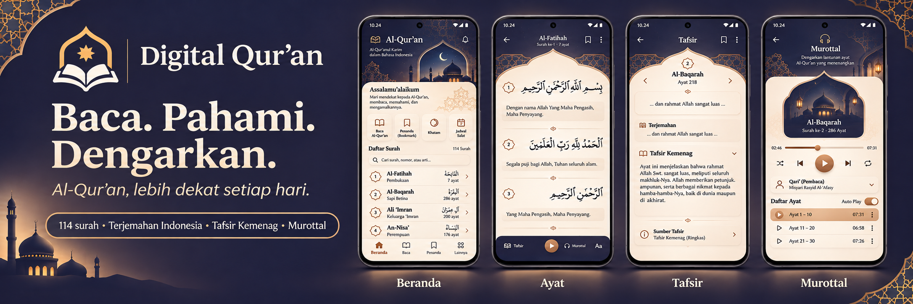

# Digital Qur’an

Aplikasi Al-Qur’an untuk Android dengan teks Arab, latin, terjemahan Indonesia, tafsir, dan murottal.

## Fitur

- Jelajahi 114 surah dan cari ayat.
- Baca teks Arab, latin, dan terjemahan bahasa Indonesia.
- Pahami makna ayat melalui tafsir Kemenag.
- Dengarkan murottal dari qari pilihan.
- Simpan penanda dan pantau progres khatam.
- Lihat jadwal salat dan arah kiblat.
- Atur pengingat membaca, ukuran huruf, dan tema tampilan.

## Materi promosi

- [Poster portrait](docs/promosi/poster-digital-quran-portrait.png)
- [Cover README](docs/promosi/readme-cover.png)
- [Mockup antarmuka](docs/mockups/)
